<div align="center">


# ccsm

**A fast, recoverable session manager for Claude Code, in your terminal.**

[](https://github.com/haitr/claude-code-session-manager/actions/workflows/ci.yml)
[](https://github.com/haitr/claude-code-session-manager/releases)
[](./LICENSE)
[](./Cargo.toml)
[](#install)

No telemetry · No network · No daemon · One binary

[**Install**](#install) · [**Keys**](#keys) · [**Filter**](#filter) · [**Themes**](#themes) · [**Safety**](#safety) · [**Build**](#build-from-source)

</div>

---

Claude Code keeps every conversation as a transcript under `~/.claude/projects`. They pile up, and there is no built-in
way to look through them or clear them out. `ccsm` is a full-screen terminal UI that lists them all, shows what each
one was about, and lets you trash the ones you no longer need without losing the ability to bring them back.

## Why ccsm

<table>
<tr>
<td width="33%" valign="top">

### 🛟 Recoverable

`d` moves a session, transcript and artifacts together, into a trash folder. `r` puts it back at its original path.
Nothing is deleted until you press `x` in the trash view.

</td>
<td width="33%" valign="top">

### 🔒 Guarded

Sessions owned by a running Claude Code process, or written in the last 10 minutes, are locked. Trash, change owner
and delete forever each ask before they act.

</td>
<td width="33%" valign="top">

### ⚡ Fast

Session metadata is cached and checked by file size and mtime, so only new or changed transcripts are re-read on
launch. One small static binary, nothing to install beside it.

</td>
</tr>
</table>

## Features

- **Folder tabs**: one tab per project folder, `[all]` first, switched with `←` `→`
- **Preview and transcript**: the latest messages of the session under the cursor, or the full transcript on `enter`
- **Bulk actions**: select rows with `space`, or everything shown with `a`, then trash, restore or delete in one go
- **Filter language**: text, regular expressions, folder names and idle time, combined in one line
- **Change owner**: hand sessions recorded under another account to the signed-in one
- **Resume from anywhere**: `y` copies `cd <cwd> && claude --resume <id>`
- **Five colour themes**: dark, light, charm, ocean, sunset
- **Standalone window**: the same UI in a self-contained egui window (`--features standalone`)

## Install

Download the archive for your platform from
[Releases](https://github.com/haitr/claude-code-session-manager/releases) and put `ccsm` on your `PATH`.

| platform | archive |
| --- | --- |
| Linux x86_64 | `ccsm-<version>-x86_64-unknown-linux-musl.tar.gz` |
| macOS Apple silicon | `ccsm-<version>-aarch64-apple-darwin.tar.gz` |
| macOS Intel | `ccsm-<version>-x86_64-apple-darwin.tar.gz` |
| Windows x86_64 | `ccsm-<version>-x86_64-pc-windows-msvc.zip` |

- The Linux build is fully static (musl): one binary for any distro.
- The Windows build links the C runtime statically, so it needs no VC++ redistributable.
- Each release carries a `SHA256SUMS` file for the archives.

Then run `ccsm`.

## Keys

| key | action |
| --- | --- |
| `↑↓` `j k` `PgUp PgDn` `Home End` | move |
| `←` `→` | switch folder tab (`[all]` first); also while typing a filter |
| `space` / `a` | select row / all shown |
| `enter` | open full transcript over the list (`↑↓` `PgUp PgDn` `Home End` scroll, `esc` close) |
| `/` | filter (see below) |
| `d` | move selection (or cursor row) to trash, with confirm |
| `c` | change owner of selection (or cursor row) to the signed-in account, with confirm |
| `y` | copy `cd <cwd> && claude --resume <id>` |
| `tab` | trash view: `space` / `a` select, `r` restore, `x` delete forever (selection, or cursor row) |
| `t` | next colour theme (dark, light, charm, ocean, sunset; not remembered) |
| `?` | key guide |
| `esc` `q` | back / quit |

## Filter

Press `/` and type comma-separated terms. Terms of the same kind are alternatives; every kind present must hold.
Case-insensitive.

| term | matches |
| --- | --- |
| `license` | label, path or id contains it |
| `regex:^fix-\d+` | same fields, as a regular expression |
| `group:nx_plugin`, `group:regex:^ios-` | folder name |
| `older:30D` | idle for at least that long |
| `newer:T12H` | active within that span |

Spans are ISO 8601 durations without the leading `P`: `30D`, `2W`, `1M`, `1Y`, `T12H`, `1DT12H`, `T30M`
(`M` is months before `T`, minutes after; a month is 30 days, a year 365).

`group:nx, group:auron, license, older:7D` = (nx or auron) and license and idle a week.

Folder tabs list only folders the filter leaves something in.

**Recipes**

| goal | keys |
| --- | --- |
| Clean up everything idle for a month | `/older:30D`, `enter`, `a`, `d` |
| See what you worked on today | `/newer:T24H` |
| Trash one project's old sessions | `/group:ios-app, older:2W`, `enter`, `a`, `d` |
| Find a session by what it was about | `/regex:token.*race` |

## Themes



`t` steps to the next theme. `ccsm` starts in charm; the choice is not remembered.

## Safety



- Trash is a move into `~/.claude/.session-cleaner-trash`; nothing is deleted until `x` in the trash view.
- Sessions owned by a running Claude Code process, or written in the last 10 minutes, are marked `●` and cannot be
  trashed or re-owned.
- Sessions owned by another account (their `session-owner` records vs `oauthAccount` in `.claude.json`) use the theme's
  second accent colour.
- Session metadata is cached in `~/.claude/ccsm-cache.json` (validated by file size + mtime), so only new or changed
  transcripts are re-read on launch. Safe to delete.
- Everything happens on your disk. `ccsm` opens no network connection.

## Build from source

Rust + [ratatui](https://ratatui.rs) / ratatui-cheese / ratatui-braille-bar.

```
cargo run                        # full-screen terminal UI
cargo run --features standalone  # self-contained egui window
cargo test
```

<details>
<summary><b>Releasing</b></summary>

- Releases are manual. Bump `version` in `Cargo.toml`, push, then Actions → release → Run workflow: `release.yml`
  builds Windows / macOS / Linux and publishes `v<version>`. It does nothing if that version is already released.
- Tick **pre-release** in the same dialog to publish a numbered pre-release `v<version>+<run number>` instead
  (`ccsm --version` shows it).
- `publish.yml` runs after a proper release to feed package channels; none are configured yet.

</details>

## Acknowledgements

- The idea comes from [claude-code-session-cleaner](https://github.com/ihoooohi/claude-code-session-cleaner) by
  ihoooohi. `ccsm` is a separate implementation in Rust.
- Built on [ratatui](https://github.com/ratatui/ratatui),
  [ratatui-cheese](https://crates.io/crates/ratatui-cheese) and
  [ratatui-braille-bar](https://crates.io/crates/ratatui-braille-bar).
- The standalone window embeds [FiraCode Nerd Font](https://www.nerdfonts.com).

## License

Released under the [MIT License](./LICENSE).
