<div align="center">



# ccsm

**Fast, recoverable session manager for Claude Code, in your terminal.**

[](https://github.com/haitr/claude-code-session-manager/actions/workflows/ci.yml)
[](https://github.com/haitr/claude-code-session-manager/releases)
[](./LICENSE)
[](./Cargo.toml)
[](#install)

No telemetry · No network · No daemon · One binary

[**Install**](#install) · [**Keys**](#keys) · [**Filter**](#filter) · [**Themes**](#themes) · [**Safety**](#safety) · [**Build**](#build-from-source)

</div>

---

Claude Code keeps every conversation under `~/.claude/projects`. They pile up. `ccsm` lists, previews, trashes and
restores them.

## Why ccsm

<table>
<tr>
<td width="33%" valign="top">

### 🛟 Recoverable

`d` moves transcript + artifacts to trash. `r` restores to original path. Nothing deleted until `x`.

</td>
<td width="33%" valign="top">

### 🔒 Guarded

Live sessions locked. Trash, change owner and delete forever all confirm first.

</td>
<td width="33%" valign="top">

### ⚡ Fast

Metadata cached; only changed transcripts re-read. One small static binary.

</td>
</tr>
</table>

## Features

- **Folder tabs**: one per project folder, `[all]` first
- **Preview**: latest messages under cursor; `enter` for full transcript
- **Bulk actions**: `space` / `a` select, then trash, restore or delete
- **Filter**: text, regex, folder, idle time, in one line
- **Change owner**: claim sessions recorded under another account
- **Resume**: `y` copies `cd <cwd> && claude --resume <id>`
- **Themes**: dark, light, charm, ocean, sunset
- **Standalone window**: same UI in egui (`--features standalone`)

## Install

Grab your archive from [Releases](https://github.com/haitr/claude-code-session-manager/releases), put `ccsm` on
`PATH`, run `ccsm`.

| platform | archive |
| --- | --- |
| Linux x86_64 | `ccsm-<version>-x86_64-unknown-linux-musl.tar.gz` |
| macOS Apple silicon | `ccsm-<version>-aarch64-apple-darwin.tar.gz` |
| macOS Intel | `ccsm-<version>-x86_64-apple-darwin.tar.gz` |
| Windows x86_64 | `ccsm-<version>-x86_64-pc-windows-msvc.zip` |

- Linux: fully static (musl), any distro.
- Windows: static C runtime, no VC++ redistributable.
- `SHA256SUMS` in every release.

## Keys

| key | action |
| --- | --- |
| `↑↓` `j k` `PgUp PgDn` `Home End` | move |
| `←` `→` | switch folder tab (`[all]` first); also while typing a filter |
| `space` / `a` | select row / all shown |
| `enter` | open full transcript over the list (`↑↓` `PgUp PgDn` `Home End` scroll, `esc` close) |
| `/` | filter (see below) |
| `d` | move selection (or cursor row) to trash, with confirm |
| `c` | change owner of selection (or cursor row) to the signed-in account, with confirm |
| `y` | copy `cd <cwd> && claude --resume <id>` |
| `tab` | trash view: `space` / `a` select, `r` restore, `x` delete forever (selection, or cursor row) |
| `t` | next colour theme (dark, light, charm, ocean, sunset; not remembered) |
| `?` | key guide |
| `esc` `q` | back / quit |

## Filter

`/`, then comma-separated terms. Same kind = alternatives; every kind present must hold. Case-insensitive.

| term | matches |
| --- | --- |
| `license` | label, path or id contains it |
| `regex:^fix-\d+` | same fields, as a regular expression |
| `group:nx_plugin`, `group:regex:^ios-` | folder name |
| `older:30D` | idle for at least that long |
| `newer:T12H` | active within that span |

Spans: ISO 8601 durations without the leading `P`: `30D`, `2W`, `1M`, `1Y`, `T12H`, `1DT12H`, `T30M`
(`M` = months before `T`, minutes after; month = 30 days, year = 365).

`group:nx, group:auron, license, older:7D` = (nx or auron) and license and idle a week.

Folder tabs show only folders with matches.

| goal | keys |
| --- | --- |
| Clean up everything idle for a month | `/older:30D`, `enter`, `a`, `d` |
| See what you worked on today | `/newer:T24H` |
| Trash one project's old sessions | `/group:ios-app, older:2W`, `enter`, `a`, `d` |
| Find a session by what it was about | `/regex:token.*race` |

## Themes


`t` = next theme. Starts in charm. Not remembered.

## Safety


- Trash = move into `~/.claude/.session-cleaner-trash`. Nothing deleted until `x` in trash view.
- `●` = live session: owned by a running Claude Code process, or written in the last 10 minutes. Cannot be trashed
  or re-owned.
- Other account's sessions (`session-owner` records vs `oauthAccount` in `.claude.json`) use the theme's second
  accent colour.
- Metadata cache: `~/.claude/ccsm-cache.json`, validated by file size + mtime. Safe to delete.
- All local. No network connection.

## Build from source

Rust + [ratatui](https://ratatui.rs) / ratatui-cheese / ratatui-braille-bar.

```
cargo run                        # full-screen terminal UI
cargo run --features standalone  # self-contained egui window
cargo test
```

<details>
<summary><b>Releasing</b></summary>

- Manual. Bump `version` in `Cargo.toml`, push, then Actions → release → Run workflow: builds Windows / macOS /
  Linux, publishes `v<version>`. No-op if that version is already released.
- Tick **pre-release**: publishes numbered `v<version>+<run number>` instead (`ccsm --version` shows it).
- `publish.yml` runs after a proper release to feed package channels; none configured yet.

</details>

## Acknowledgements

- Idea: [claude-code-session-cleaner](https://github.com/ihoooohi/claude-code-session-cleaner) by ihoooohi. `ccsm` is
  a separate Rust implementation.
- Built on [ratatui](https://github.com/ratatui/ratatui), [ratatui-cheese](https://crates.io/crates/ratatui-cheese),
  [ratatui-braille-bar](https://crates.io/crates/ratatui-braille-bar).
- Standalone window embeds [FiraCode Nerd Font](https://www.nerdfonts.com).

## License

[MIT](./LICENSE).
